Sí. Este diagrama resume toda la secuencia de `eclipse_analysis.py`:

```mermaid
flowchart TD
    A([Inicio]) --> B[Recibir archivo de resultados y opciones]

    subgraph C[Lectura y filtrado]
        B --> C1[Abrir archivo ZIP]
        C1 --> C2[Leer distortion_results.txt]
        C1 --> C3[Leer CATALOGUE_MATCHED_ERRORS.csv]
        C2 --> C4[Obtener fecha, lugar, escala de placa e incertidumbres]
        C3 --> C5[Convertir columnas a valores numéricos]
        C5 --> C6[Filtrar por magnitud límite]
        C6 --> C7{¿Eliminar estrellas dobles?}
        C7 -- Sí --> C8[Eliminar estrellas marcadas como dobles]
        C7 -- No --> C9[Conservar todas las estrellas]
    end

    subgraph D[Geometría del eclipse]
        C4 --> D1[Calcular posición aparente del Sol y la Luna]
        D1 --> D2[Calcular radios angulares aparentes]
        D2 --> D3[Seleccionar centro: Sol o Luna]
        C8 --> D4[Convertir RA y DEC observadas a vectores unitarios]
        C9 --> D4
        D3 --> D4
        D4 --> D5[Convertir RA y DEC del catálogo a vectores unitarios]
        D5 --> D6[Calcular distancia angular de cada estrella al centro]
        D6 --> D7[Convertir distancia a radios solares]
    end

    D7 --> E{¿Limitar radios solares?}
    E -- Sí --> E1[Aplicar máscara radial]
    E -- No --> E2[Utilizar todas las estrellas]
    E1 --> F
    E2 --> F

    F[Calcular vectores radiales desde el centro] --> G[Definir modelos de deflexión]

    subgraph H[Modelos físicos]
        G --> H1[Modelo 1: d = L / r]
        G --> H2[Modelo 2: d = A / r^B]
        G --> H3[Modelo 3: d = A / r + B r]
    end

    H1 --> I1[Corregir posiciones catalogadas con la deflexión]
    H2 --> I2[Corregir posiciones catalogadas con la deflexión]
    H3 --> I3[Corregir posiciones catalogadas con la deflexión]

    I1 --> J1[Normalizar vectores corregidos]
    I2 --> J2[Normalizar vectores corregidos]
    I3 --> J3[Normalizar vectores corregidos]

    J1 --> K1[Calcular rotación óptima]
    J2 --> K2[Calcular rotación óptima]
    J3 --> K3[Calcular rotación óptima]

    K1 --> L1[Calcular RMS angular]
    K2 --> L2[Calcular RMS angular]
    K3 --> L3[Calcular RMS angular]

    L1 --> M1[Optimizar L con Nelder-Mead]
    L2 --> M2[Optimizar A y B con Nelder-Mead]
    L3 --> M3[Optimizar A y B con Nelder-Mead]

    M1 --> N[Usar el mejor L del modelo 1]
    N --> O[Calcular rotación final]
    O --> P[Rotar posiciones observadas]
    P --> Q[Calcular distancias radiales observadas]
    Q --> R[Calcular deflexión observada en arcsec]

    R --> S[Leer escala de placa inicial s₀]

    subgraph T[Ajustes estadísticos]
        S --> T1{¿Método 1 incluido?}
        T1 -- Sí --> T2[Regresión d = L / r]
        T2 --> T3[Obtener L y varianza estadística]
        T3 --> T4[Propagar incertidumbre de escala de placa]
        T4 --> T5[Construir μ₁ y Σ₁]

        S --> T6{¿Método 2 incluido?}
        T6 -- Sí --> T7[Regresión d = A / r + B r]
        T7 --> T8[Convertir B en corrección de escala]
        T8 --> T9[Construir μ₂ y Σ₂]
    end

    subgraph U[Distribución normal bivariada]
        T5 --> U1[μ = L y escala de placa]
        T9 --> U2[μ = L y escala de placa]
        U1 --> U3[Calcular σL, σs y covarianza]
        U2 --> U4[Calcular σL, σs y covarianza]
        U3 --> U5[Calcular correlación de Pearson]
        U4 --> U6[Calcular correlación de Pearson]
    end

    subgraph V[Elipses de covarianza]
        U5 --> V1[Crear elipse de 1σ del método 1]
        U5 --> V2[Crear elipse de 2σ del método 1]
        U6 --> V3[Crear elipse de 1σ del método 2]
        U6 --> V4[Crear elipse de 2σ del método 2]
        V1 --> V5[Centro: μ]
        V2 --> V5
        V3 --> V5
        V4 --> V5
        V5[Aplicar desviaciones, correlación y rotación]
    end

    V --> W[Guardar ECLIPSE_confidence_ellipse.png]
    W --> X{¿Mostrar gráficos?}
    X -- Sí --> Y[Mostrar elipse en pantalla]
    X -- No --> Z[Continuar]
    Y --> AA[Crear gráfico de deflexión frente a radio solar]
    Z --> AA
    AA --> AB[Guardar resultados textuales]
    AB --> AC([Fin])
```

**La parte** más importante es la transformación:

$$
\text{estrellas}
\rightarrow
\text{deflexiones observadas}
\rightarrow
\text{ajuste de } L \text{ y } s
\rightarrow
\text{matriz de covarianza}
\rightarrow
\text{elipse bivariada}
$$

La elipse final no representa la distribución espacial de las estrellas, sino la incertidumbre conjunta de:

$$
(L,\ s)
$$

donde `L` es la deflexión y `s` la escala de placa.